<p align="center">
  
</p>

<h1 align="center">Karobar ERP</h1>

<p align="center">
  <strong>Stock, sales, accounts and payroll for small businesses, in one place.</strong>
</p>

<p align="center">
  <a href="https://github.com/ahmershahdev/karobar-erp/actions/workflows/backend.yml"></a>
  <a href="https://github.com/ahmershahdev/karobar-erp/actions/workflows/frontend.yml"></a>
  <a href="https://github.com/ahmershahdev/karobar-erp/actions/workflows/codeql.yml"></a>
  <a href="LICENSE"></a>
</p>

<p align="center">
  <a href="#what-it-does">What it does</a> ·
  <a href="#screenshots">Screenshots</a> ·
  <a href="#how-it-fits-together">How it fits together</a> ·
  <a href="#the-data-model">Data model</a> ·
  <a href="#run-it-locally">Run it</a> ·
  <a href="#documentation">Docs</a>
</p>

Karobar ERP is for shops, wholesalers and distributors that run on paper registers or
spreadsheets and find the big ERPs too heavy. One installation serves many businesses (tenants),
each with its own warehouses, customers, books and staff. Every sale, purchase and payment posts
its own double-entry journal entry, so the trial balance, profit and loss and balance sheet are
always up to date. The app speaks English, Urdu and Arabic, right to left where needed.

It is built for people who are not accountants, and who may not read comfortably: plain words, a
picture beside every screen, big buttons, and step-by-step help on each page.

> Status: `v0.6.0`, every module built. The last milestone (end-to-end tests and the public demo)
> comes before `v1.0.0`. See [docs/roadmap.md](docs/roadmap.md) for the milestones and
> [docs/status.md](docs/status.md) for where the work is.
>
> Website: [karobarerp.ahmershah.dev](https://karobarerp.ahmershah.dev)

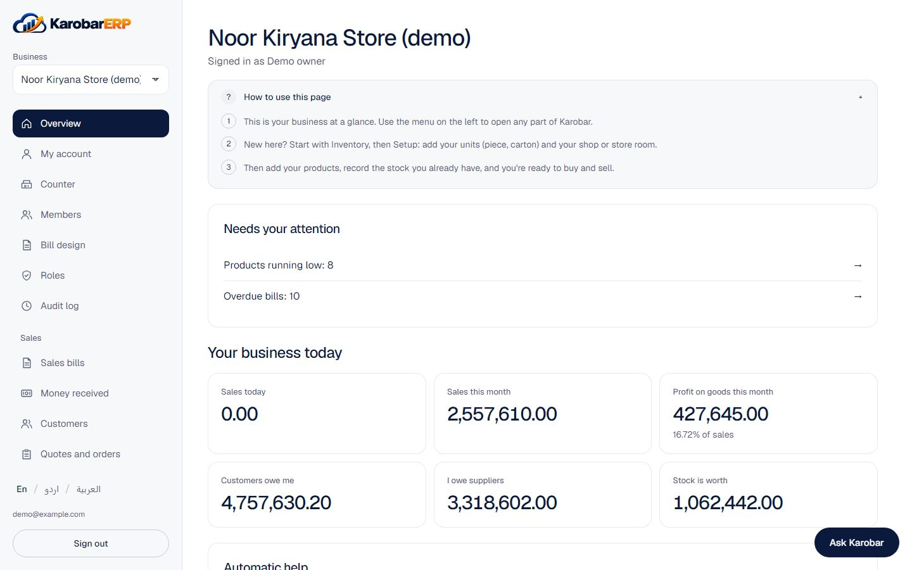

## What it does

- **Inventory.** Products with packs and barcodes (buy by the carton, sell by the piece), several
  warehouses, receipts, issues, transfers and counts, batches with expiry dates, low-stock and
  expiry alerts by email, and stock valued by FIFO or moving average.
- **Sales.** Quotations, orders, bills, money received, returns and credit notes, customer credit
  limits, discounts per line or per bill with a limit per role, six printable bill designs on A4
  or an 80 mm roll, and bills shared as a signed link or on WhatsApp.
- **The counter.** A fast point-of-sale screen: scan, take cash or card, give change, and count
  the drawer at the end of the day.
- **Purchasing.** Suppliers, purchase orders, goods received, supplier bills and payments, and
  what you owe by how late it is.
- **Accounting.** A ready chart of accounts, a journal entry posted by every document, fiscal
  periods, the ledger and trial balance, profit and loss, balance sheet, cash flow, and the sales
  tax (GST/VAT) report, with CSV exports.
- **HR and payroll.** Employees, contracts and salary structures, the work week and public
  holidays, leave and attendance, monthly payroll with income tax from the official slabs,
  payslips as PDF, salary payments, EOBI and social security, GOSI and the UAE pension,
  end-of-service gratuity, and the UAE WPS salary file. See the
  [Payroll](https://github.com/ahmershahdev/karobar-erp/wiki/Payroll) wiki page.
- **Ask Karobar.** An optional chat that answers questions about your business with only the
  figures your role may see, and prepares draft bills and orders for you to confirm. Its messages
  are signed, so a changed one is caught.
- **Platform.** Many businesses on one installation, roles and permissions per module, an audit
  log of every change, a business home page with what needs attention, a daily summary email,
  sign-in with email or Google, and English, Urdu and Arabic on every screen and printed bill.

## Screenshots

These come from the invented demo businesses (see "Try it with data" below).

| | |
|---|---|
| 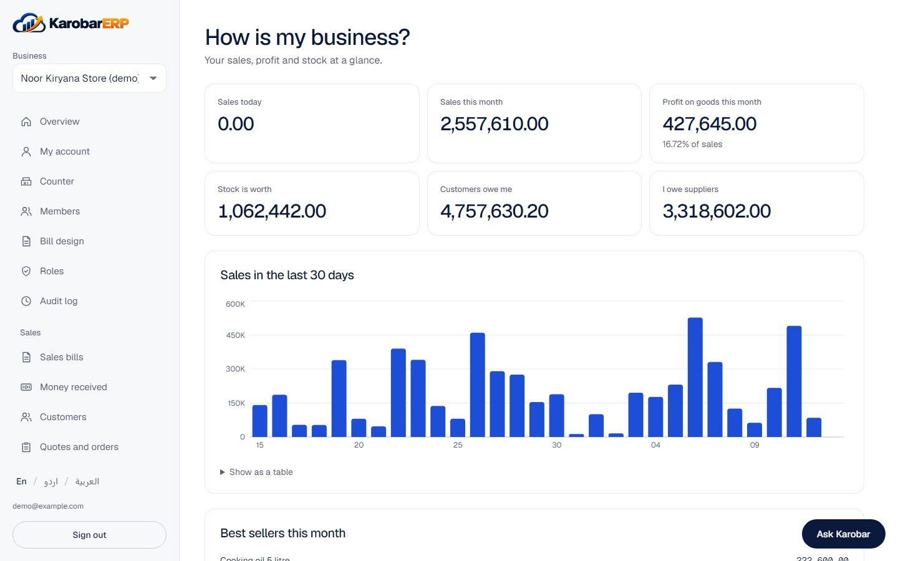 | 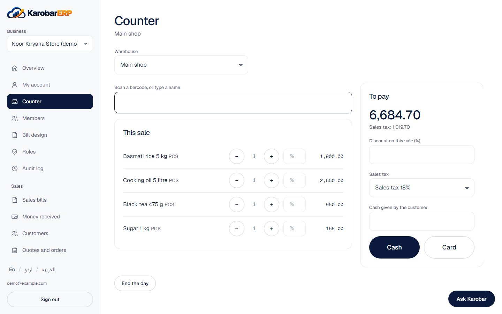 |
| How is my business: sales, profit and stock | The counter |
| 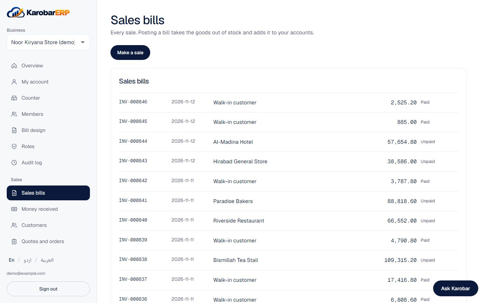 | 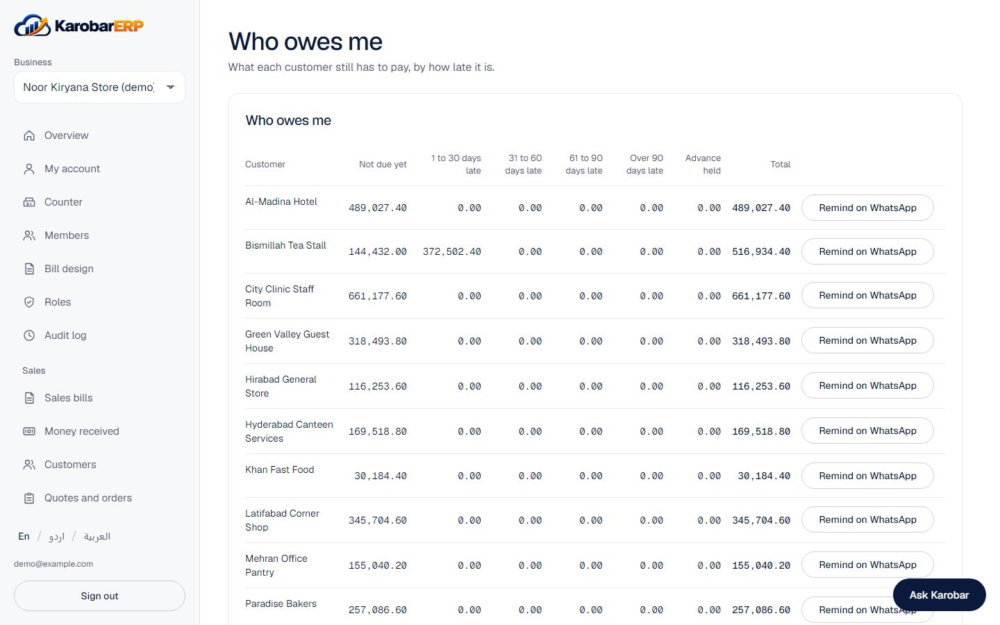 |
| Sales bills | Who owes me, by how late |
| 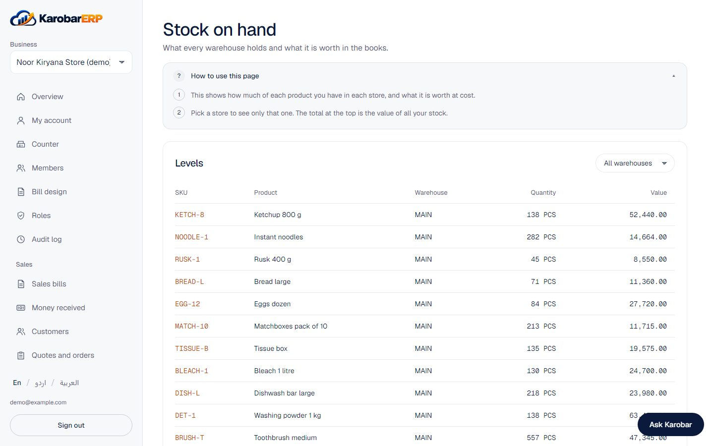 | 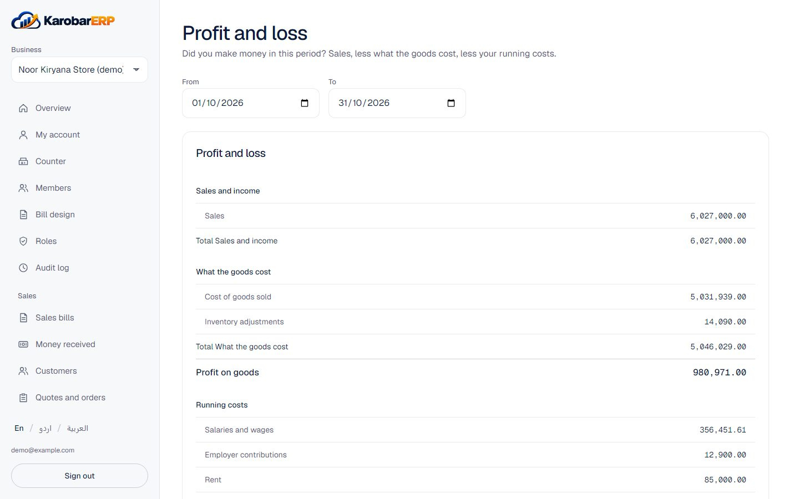 |
| Stock on hand and its value | Profit and loss |
| 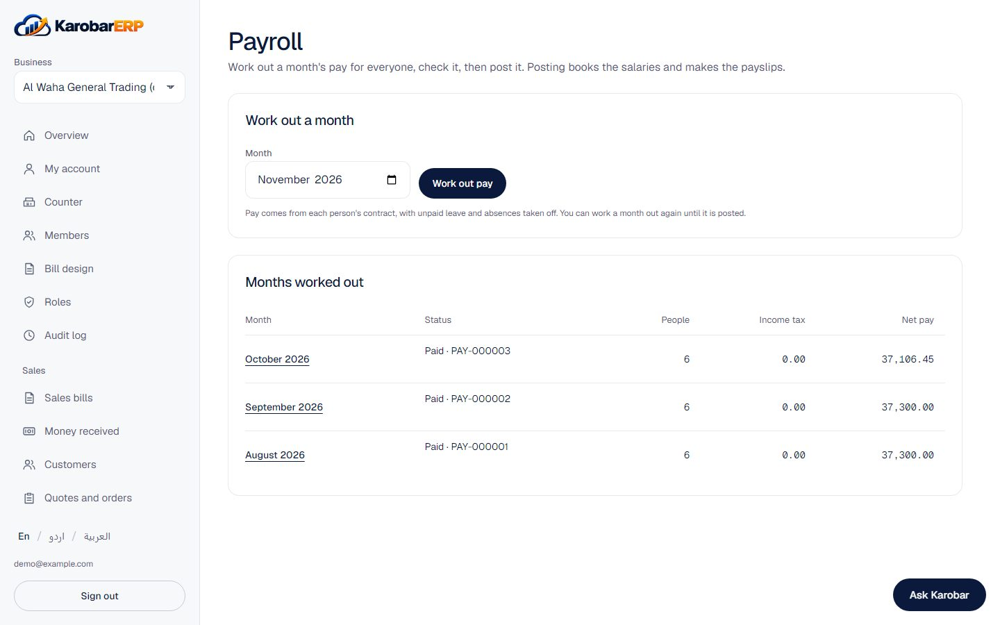 | 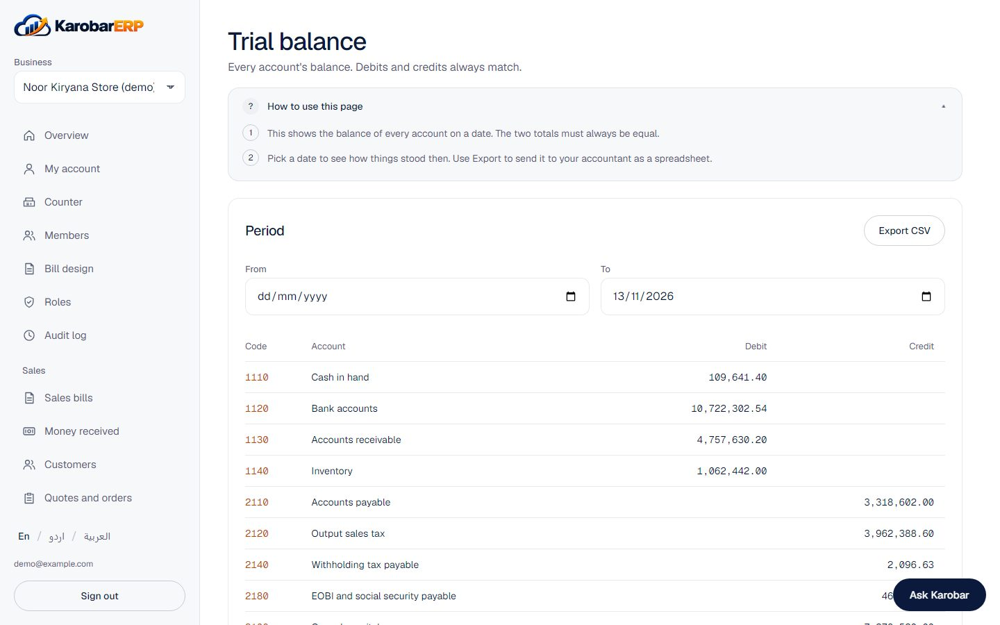 |
| Payroll for the Dubai company | Trial balance |
| 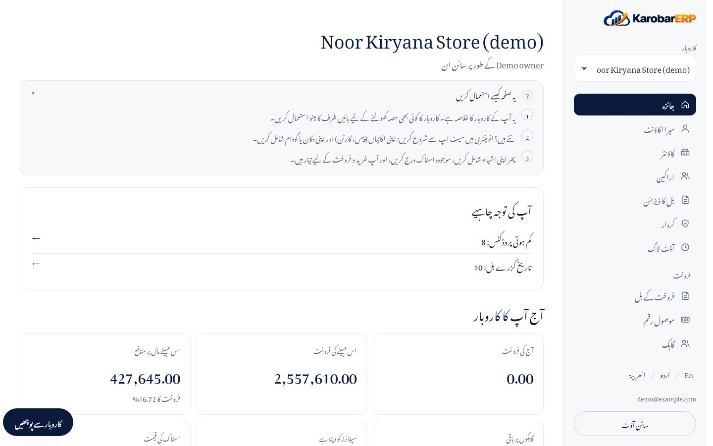 | 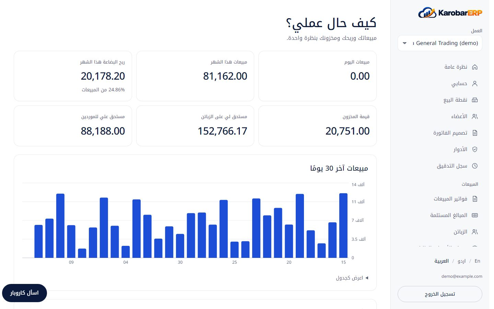 |
| In Urdu, right to left | In Arabic |

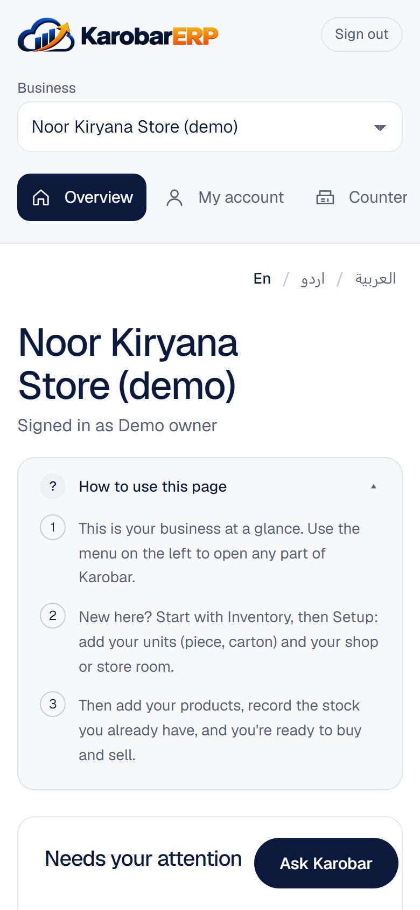

## Stack

| Part | Tools |
|---|---|
| API and jobs | Python 3.12, Django 5.2, Django REST Framework, drf-spectacular, Celery |
| Data | MySQL 8.4 (InnoDB, row locks for stock), Redis (queue and cache) |
| Web | React, TypeScript (strict), Vite, Tailwind CSS, TanStack Query and Table, Recharts, i18next, anime.js |
| Documents | WeasyPrint for PDF invoices, payslips and reports |
| Quality | pytest, factory_boy, Vitest, Ruff, mypy, ESLint, Prettier, GitHub Actions, CodeQL |
| Run | Docker Compose |

## How it fits together

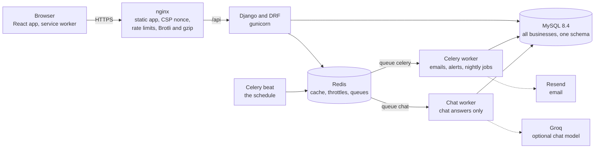

A request for one business follows the same path every time: the session says who is asking, the
`X-Tenant` header says for which business, and every query goes through a manager that only
returns that business's rows.

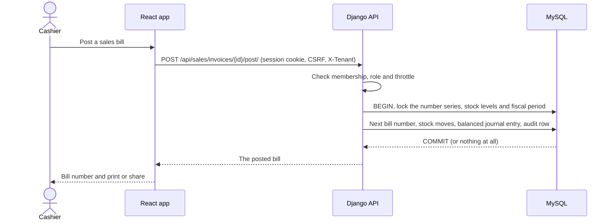

## The data model

Every table below except `User` and `Tenant` carries a `tenant` column. The main tables and how
they link, with line tables and settings left out for room:

```mermaid
erDiagram
    USER ||--o{ MEMBERSHIP : "belongs through"
    TENANT ||--o{ MEMBERSHIP : has
    TENANT ||--o{ ROLE : defines
    ROLE ||--o{ MEMBERSHIP : grants
    TENANT ||--o{ INVITATION : sends
    TENANT ||--o{ AUDIT_EVENT : records
    USER ||--o{ AUDIT_EVENT : causes

    ACCOUNT ||--o{ ACCOUNT : "parent of"
    FISCAL_YEAR ||--o{ FISCAL_PERIOD : "split into"
    JOURNAL_ENTRY ||--|{ JOURNAL_LINE : has
    ACCOUNT ||--o{ JOURNAL_LINE : "debited or credited"
    JOURNAL_ENTRY |o--o| JOURNAL_ENTRY : reverses

    CATEGORY ||--o{ PRODUCT : groups
    UNIT ||--o{ PRODUCT : "base unit of"
    PRODUCT ||--o{ PRODUCT_UNIT : "packed as"
    PRODUCT ||--o{ BATCH : "made in"
    PRODUCT ||--o{ STOCK_LEVEL : "on hand as"
    WAREHOUSE ||--o{ STOCK_LEVEL : holds
    PRODUCT ||--o{ COST_LAYER : "valued by"
    STOCK_ENTRY ||--|{ STOCK_MOVE : makes
    PRODUCT ||--o{ STOCK_MOVE : moves
    WAREHOUSE ||--o{ STOCK_MOVE : "in or out of"
    STOCK_ENTRY |o--o| JOURNAL_ENTRY : posts

    SUPPLIER ||--o{ PURCHASE_ORDER : receives
    PURCHASE_ORDER ||--o{ GOODS_RECEIPT : "fulfilled by"
    GOODS_RECEIPT ||--|| STOCK_ENTRY : "brings in"
    SUPPLIER ||--o{ SUPPLIER_BILL : sends
    SUPPLIER_BILL ||--o| JOURNAL_ENTRY : posts
    SUPPLIER ||--o{ SUPPLIER_PAYMENT : "is paid by"
    SUPPLIER_PAYMENT ||--o{ SUPPLIER_BILL : "allocated to"

    CUSTOMER ||--o{ SALES_ORDER : places
    SALES_ORDER ||--o{ INVOICE : "billed by"
    CUSTOMER ||--o{ INVOICE : owes
    INVOICE ||--|{ INVOICE_LINE : has
    PRODUCT ||--o{ INVOICE_LINE : "sold on"
    TAX_RATE ||--o{ INVOICE_LINE : "applied to"
    INVOICE ||--o| JOURNAL_ENTRY : posts
    INVOICE ||--o| STOCK_ENTRY : "takes out"
    CUSTOMER ||--o{ CUSTOMER_RECEIPT : pays
    CUSTOMER_RECEIPT ||--o{ INVOICE : "allocated to"
    INVOICE ||--o{ CREDIT_NOTE : "corrected by"
    POS_SESSION ||--o{ POS_SALE : rings
    POS_SALE ||--|| INVOICE : "is a"

    DEPARTMENT ||--o{ EMPLOYEE : employs
    EMPLOYEE ||--o{ CONTRACT : "works under"
    SALARY_STRUCTURE ||--o{ CONTRACT : "pays by"
    SALARY_STRUCTURE ||--|{ SALARY_COMPONENT : "made of"
    EMPLOYEE ||--o{ LEAVE_REQUEST : asks
    EMPLOYEE ||--o{ ATTENDANCE : "is marked in"
    TAX_TABLE ||--|{ TAX_SLAB : has
    PAYROLL_RUN ||--|{ PAYSLIP : produces
    EMPLOYEE ||--o{ PAYSLIP : receives
    TAX_TABLE ||--o{ PAYROLL_RUN : "taxed by"
    PAYROLL_RUN ||--o| JOURNAL_ENTRY : posts
    PAYROLL_RUN ||--o| SALARY_PAYMENT : "paid by"
    EMPLOYEE ||--o| GRATUITY_PAYOUT : "leaves with"

    USER ||--o{ CHAT_MESSAGE : writes
    CHAT_MESSAGE ||--o| CHAT_JOB : "answered by"
```

The rules these tables keep (posted documents never change, every entry balances, stock only
moves through stock moves) are in [docs/architecture.md](docs/architecture.md).

## Why it exists

The hard parts of an ERP are not the forms: they are books that always balance, stock that stays
right when two cashiers sell the last item at the same moment, and one business never seeing
another's data. Karobar ERP is built around those three rules, with tests for each.

## Security and speed

- Passwords hashed with Argon2id, with bcrypt as a fallback.
- Session cookies with CSRF protection, a nonce-based Content Security Policy, and rate limits on
  every endpoint.
- Public forms guarded by reCAPTCHA v3, a v2 checkbox when v3 is unsure, and a honeypot field.
- Every change to business data goes in an audit log; chat messages are signed in a chain.
- Uploaded logos and signatures are checked and saved again as a clean copy.
- Redis for cache, sessions and throttles; Brotli and gzip compressed at build time; WebP images.
- A service worker keeps the app's code, never business data, so losing the connection shows a
  helpful screen and recovers by itself.

Details are in [docs/security.md](docs/security.md).

## Run it locally

You need Docker, Python 3.12 and Node 22. One command starts everything:

```sh
git clone https://github.com/ahmershahdev/karobar-erp.git
cd karobar-erp
npm run dev
```

The first run creates `backend/.env` with a random secret key, the Python virtual environment and
`node_modules`, starts MySQL and Redis in Docker, applies migrations, then runs Django on :8000,
two Celery workers (one only for chat answers), Celery beat and Vite on <http://localhost:5173>. Emails (sign-up confirmation, password
reset, invitations) are printed in the worker's log in development. Ctrl+C stops the app
processes; `docker compose stop` stops the databases.

To run the pieces by hand instead:

```sh
git clone https://github.com/ahmershahdev/karobar-erp.git
cd karobar-erp
docker compose up -d mysql redis

cd backend
python -m venv .venv
.venv/bin/pip install -r requirements/dev.txt     # .venv\Scripts\pip on Windows
cp .env.example .env                              # then set DJANGO_SECRET_KEY
.venv/bin/python manage.py migrate
.venv/bin/python manage.py createsuperuser
.venv/bin/python manage.py runserver

cd ../frontend
npm ci
npm run dev                                       # http://localhost:5173, proxies /api to :8000
```

### Try it with data

Set `DEMO_MODE=true` and a `DEMO_PASSWORD` in `backend/.env`, then run `.venv/bin/python manage.py seed_demo`. It makes two invented businesses, a Pakistani kiryana store and a Dubai trading company, each with a year of purchases, sales, returns, payments and payroll. Sign in as `demo@example.com` (or your `DEMO_EMAIL`). A year takes about half an hour per business on a laptop, because every document goes through the normal posting rules; `--days 30` is quicker. Running it again replaces only the demo businesses.

The test database needs one grant on a fresh MySQL volume; `deploy/mysql/init.sql` does it for
the Compose service.

## Checks

```sh
(cd backend && ruff check . && ruff format --check . && mypy . && pytest)
(cd frontend && npm run lint && npm run typecheck && npm test && npm run build)
(cd e2e && npm ci && npm run seed && npm test)        # end-to-end, see docs/testing.md
```

## Documentation

- [docs/roadmap.md](docs/roadmap.md): milestones M1 to M7 and what "done" means
- [docs/architecture.md](docs/architecture.md): modules, data model, tenancy and decisions
- [docs/status.md](docs/status.md): current state, updated every session
- [docs/security.md](docs/security.md): tenancy, sessions, CSP, rate limits, locking
- [docs/testing.md](docs/testing.md): end-to-end, security and load tests, and what they found
- [docs/seo.md](docs/seo.md) and [docs/design.md](docs/design.md)
- [docs/locale-review.md](docs/locale-review.md): Urdu and Arabic phrases waiting for a native reader
- [CONTRIBUTING.md](CONTRIBUTING.md), [CODE_OF_CONDUCT.md](CODE_OF_CONDUCT.md) and
  [SECURITY.md](SECURITY.md)
- [Wiki](https://github.com/ahmershahdev/karobar-erp/wiki): using Karobar day to day, payroll, the
  demo, running it yourself and hosting it

## Related

- [HolidayOps](https://github.com/ahmershahdev/holidayops): business-day calendars for countries
  and companies.
- [MarketClock](https://github.com/ahmershahdev/marketclock): trading days and settlement dates
  for stock exchanges.
- [OfflineShelf](https://github.com/ahmershahdev/offlineshelf): Wikipedia reading lists for
  offline use.

## License

[MIT](LICENSE).
