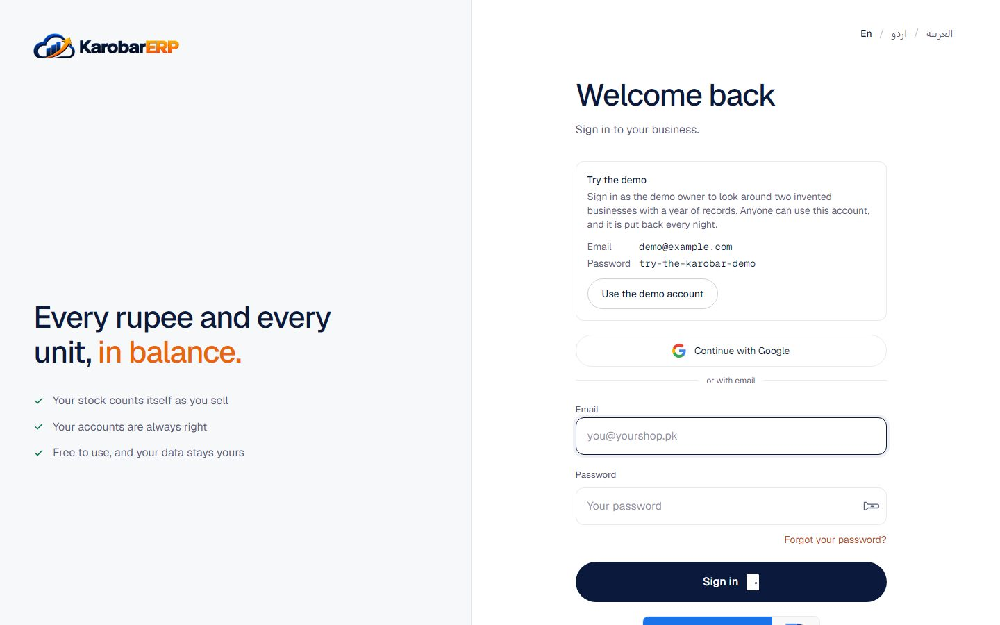

# Demo

The demo has two invented businesses, each with months of purchases, sales, returns, payments,
stock and payroll, all posted through the same rules as real work:

- **Noor Kiryana Store (demo)**: a kiryana and wholesale shop in Hyderabad, in Pakistani rupees,
  with sales tax, Urdu as its language and payroll with EOBI.
- **Al Waha General Trading (demo)**: a trading company in Dubai, in dirhams, with VAT, FIFO stock
  costing, gratuity, the UAE pension and the WPS salary file.

Every name, number and ID in them is made up. The EOBI and pension rates in the demo are invented
too, and say so.

## On the public demo

The sign-in page shows the demo email and password, with a button that fills them in. Anyone can
use this account, so it can't change its own name, email or password, invite people, create or
hand over businesses, or use the chat. Inside the two businesses you can do anything: sell,
receive goods, post, run payroll. Everything is put back every night.



## On your own computer

In `backend/.env` set:

```sh
DEMO_MODE=true
DEMO_PASSWORD=choose-one
DEMO_DAYS=120
```

then run `.venv/bin/python manage.py seed_demo` in `backend/`. A full year (`DEMO_DAYS=365`) takes about
half an hour per business on a laptop, because each document goes through the normal posting
rules. Running it again replaces the demo businesses and leaves every other business alone.
Never turn `DEMO_MODE` on for a real installation.
