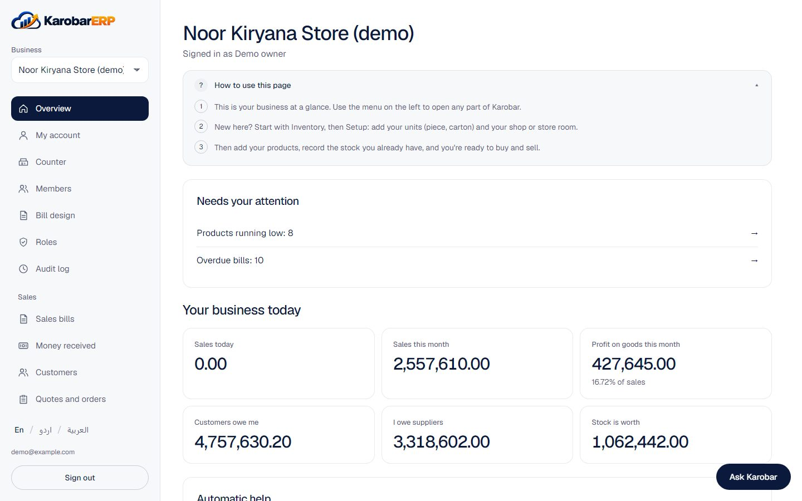

# Karobar ERP wiki

Karobar ERP is free, open-source software for shops, wholesalers and distributors. It keeps your
stock, sales, purchases, money, staff and payroll in one place, and writes the accounts for you
as you work. It speaks English, Urdu and Arabic.

The wiki is for people using or hosting Karobar. For the code and its design, see the
[repository](https://github.com/ahmershahdev/karobar-erp) and its `docs/` folder.

## Pages

- [[Using Karobar]]: a day in the shop, screen by screen
- [[Payroll]]: salaries, tax, EOBI, GOSI, gratuity and the WPS file
- [[Demo]]: two invented businesses to try it with
- [[Getting Started]]: run Karobar on your own computer
- [[Self Hosting]]: put it on a server with Docker Compose
- [[Concepts]]: businesses, roles, posting, tax and the audit log
- [[Security Model]]: how your data is kept apart and safe
- [[FAQ]]

## Where it stands

Every module is built: inventory, purchasing, sales and the counter, accounting, tax, reports, HR
and payroll, and a business chat. The last milestone before `v1.0.0` adds end-to-end tests and
the public demo. See the
[roadmap](https://github.com/ahmershahdev/karobar-erp/blob/main/docs/roadmap.md).
