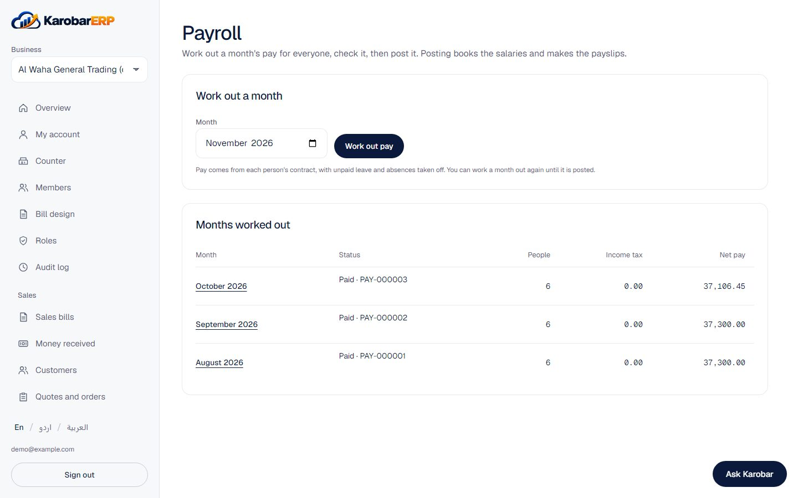
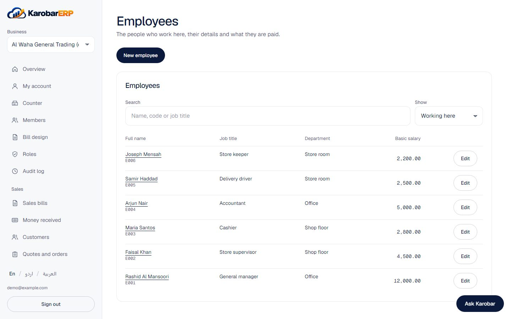

# Payroll

Payroll works for Pakistan, the United Arab Emirates and Saudi Arabia. The country comes from the
business's holiday and work week settings under HR.

## Before the first month

1. **Employees and contracts.** Add each person under Employees, then a contract with their basic
   salary and a salary structure (allowances and deductions on top of basic).
2. **Work week and holidays.** Set the weekend and fill in the year's public holidays. Moon-sighted
   dates (Eid) are estimates; change them when they are announced.
3. **Leave and attendance.** Approved unpaid leave and absences are taken off pay automatically.

## Each month

Work out the month, check the figures, then post it. Posting books the salaries in one journal
entry and makes the payslips (PDF). Then record the payment from your bank or cash, and download
the bank transfer list. A posted month that turns out wrong, and isn't paid yet, can be undone and
worked out again.

## What Karobar knows, and what you enter

Karobar only ships legal figures it could read in an official text, with the source written next
to them. Everything else you enter from your own documents.

| Country | Shipped with the app | You enter |
|---|---|---|
| Pakistan | Income tax slabs for tax year 2027 (Finance Act 2026); Islamabad and Sindh minimum wages from July 2026 | EOBI and provincial social security rates; other provinces' minimum wages; slabs for later tax years when the Finance Act is out |
| UAE | The end-of-service gratuity rule from Article 51 of the labour law | Pension (GPSSA) rates for nationals, from your statement |
| Saudi Arabia | The gratuity rule from Articles 84 and 85 of the labour law | GOSI rates, from your statement |

The law texts were read in English translation; the Arabic texts govern. Check every figure
against the law before relying on it.

## Gratuity, insurance and bank files

- **End-of-service gratuity** (UAE and Saudi Arabia) is set aside every month as a cost, and paid
  from the employee's page once their last month is posted, by the reason they left.
- **Social insurance** (EOBI, social security, GOSI, the UAE pension) is worked out on each
  payslip: the staff share as a deduction, the employer's share as a cost.
- **UAE WPS salary file (SIF)** downloads for any posted month, once the MOL establishment ID and
  routing codes are filled in. Saudi businesses use the bank transfer list until a current Mudad
  or bank template is added.
