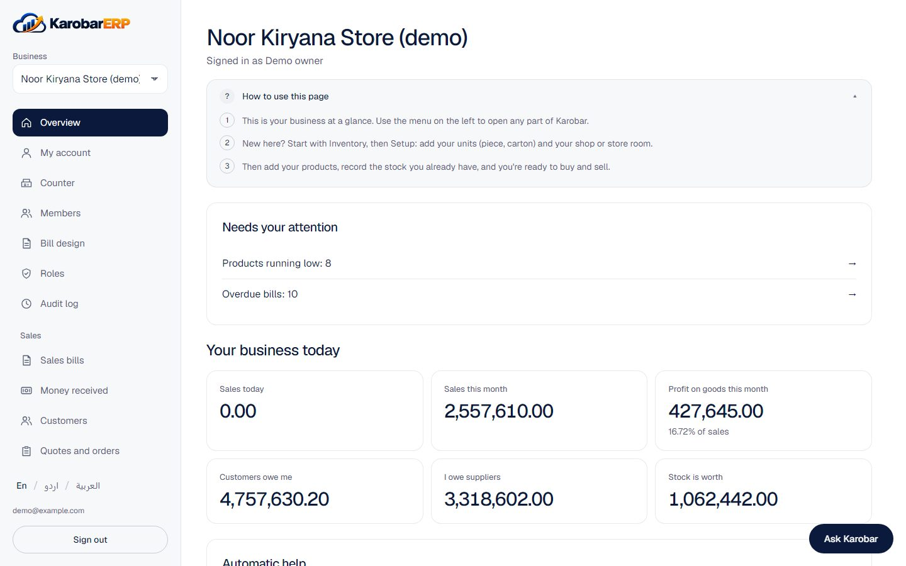
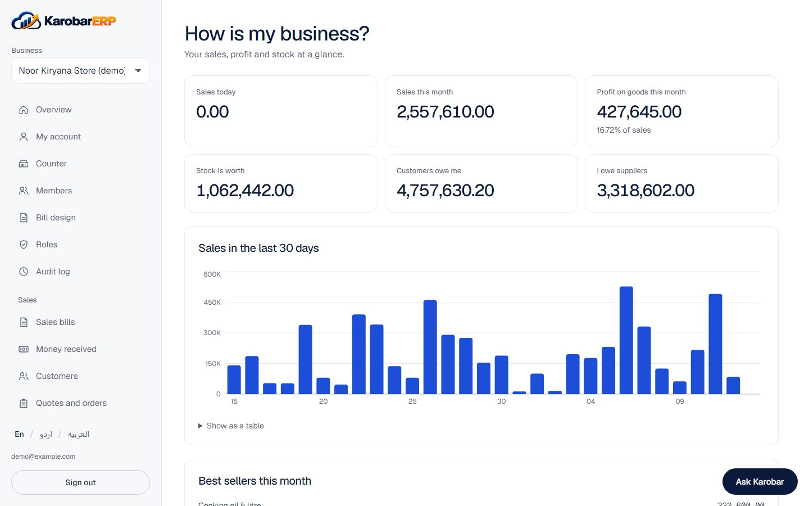
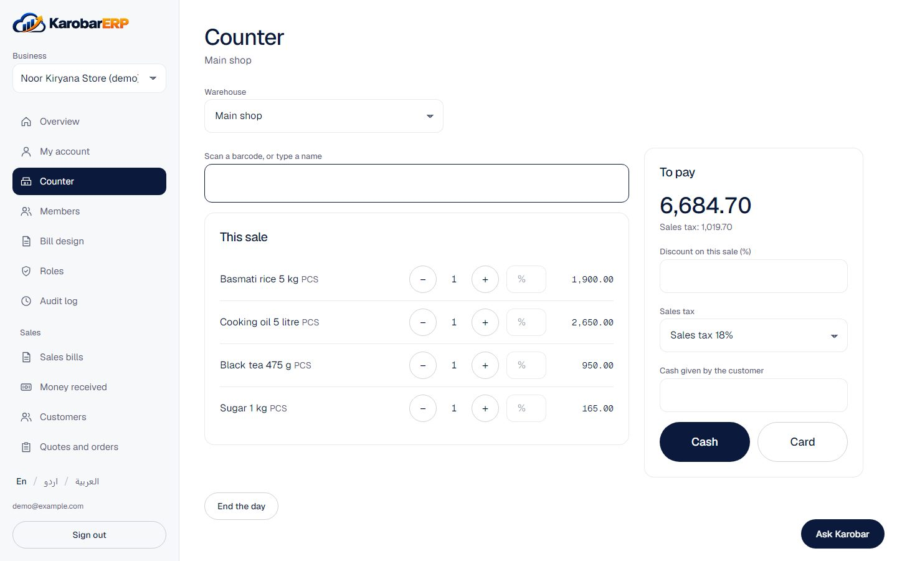
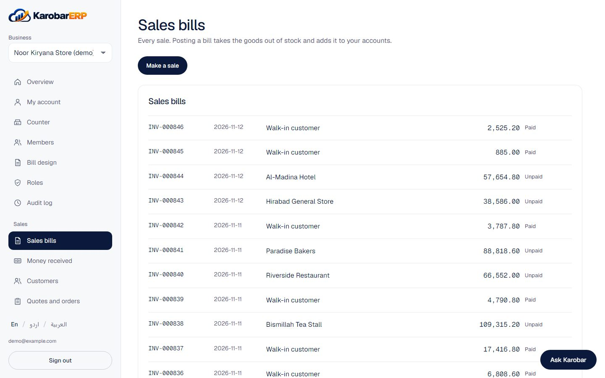
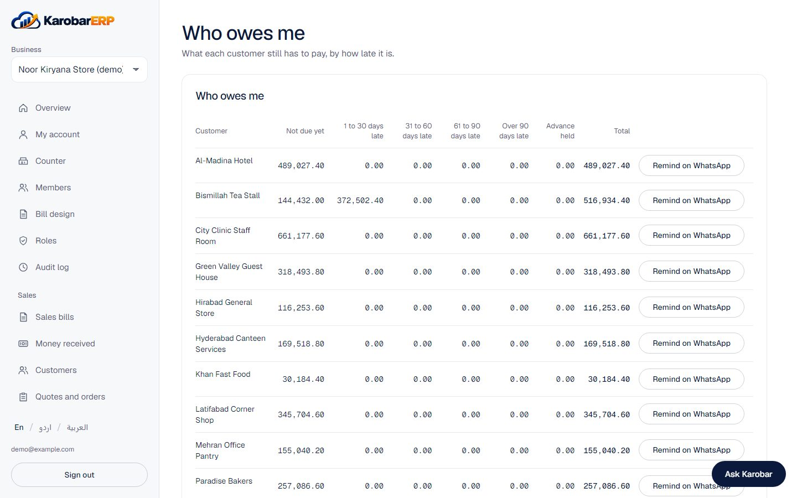
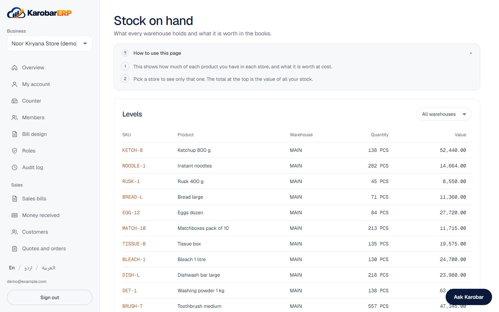
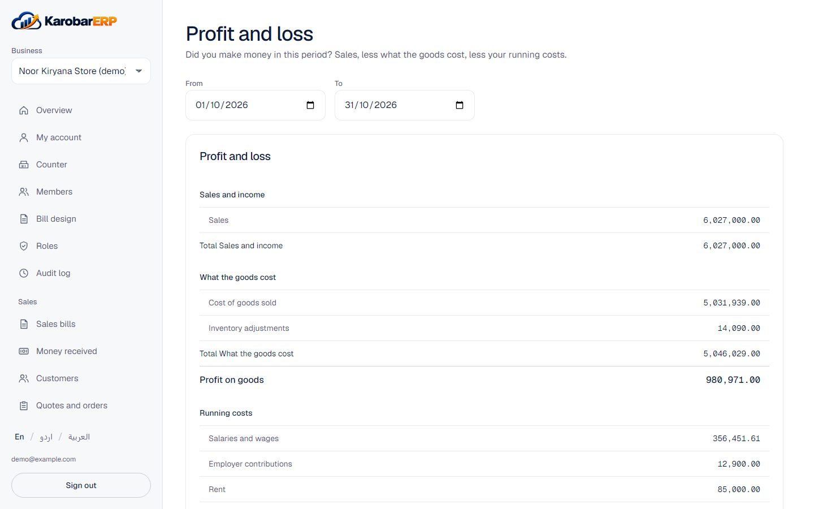
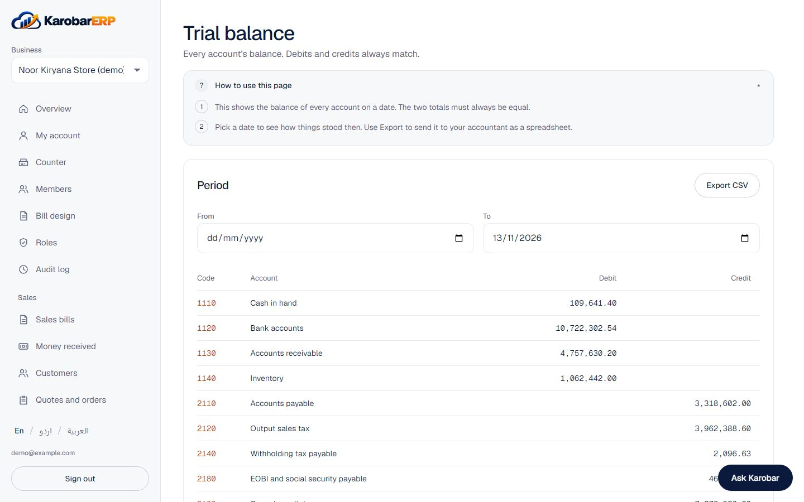
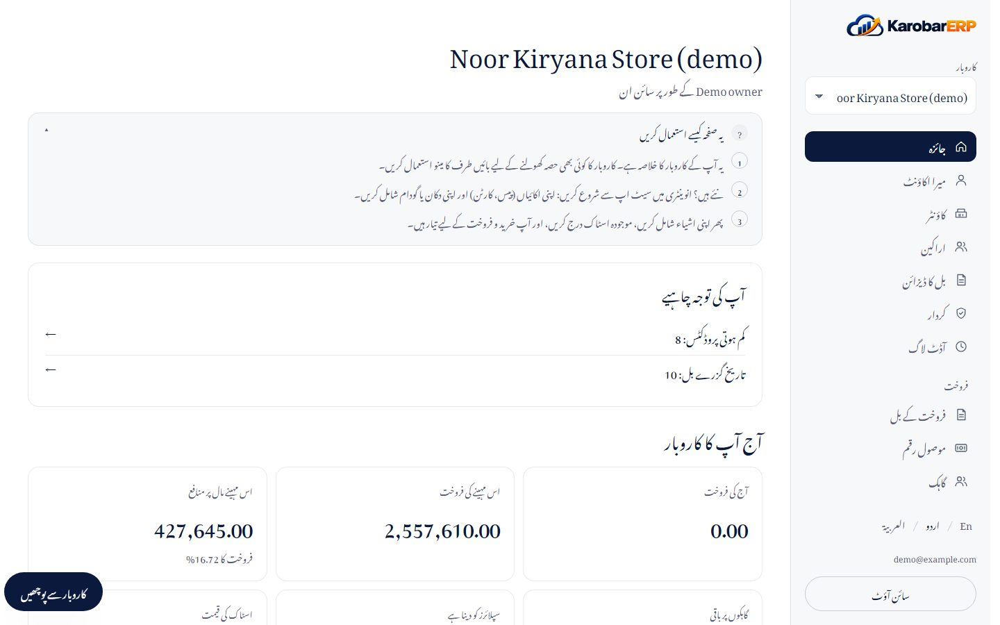
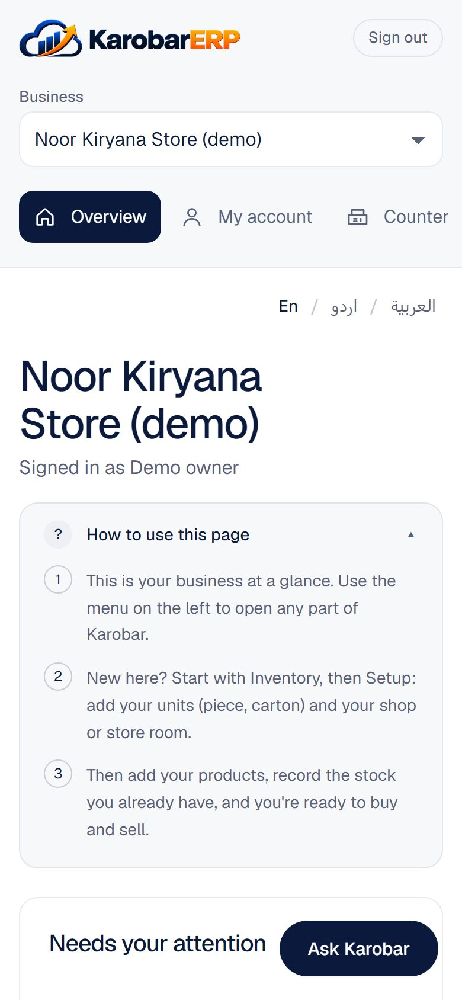

# Using Karobar

This page walks through a normal day in a shop. The pictures come from the demo kiryana store; see
[[Demo]] to try it yourself.

## Your business at a glance

After signing in, you land on your business's home page. It shows today's sales, what needs your
attention (stock running low, bills past their due date, tills left open) and big buttons for the
things people do most.

**How is my business?** shows sales, profit on goods and stock value, with the last 30 days as a
chart.

## Selling

**At the counter.** Open the counter, count the cash in the drawer, and start selling: scan a
barcode or type a name, take cash or card, and Karobar works out the change. At the end of the
day, count the drawer again; any difference is written into the books for you.

**Bills for customers on credit.** Under Sales, make a bill for a customer. Posting it takes the
goods out of stock, adds the sale to your accounts and to what the customer owes. When they pay,
record the money under Money received and pick the bills it is for.

**Who owes me?** lists each customer's unpaid bills by how late they are, with a button to remind
them on WhatsApp.

Returns are made from the original bill ("Customer returned goods"). Discounts can be given per
line or on the whole bill, up to the limit set on each person's role.

## Buying and stock

Order from a supplier, receive the goods when they arrive, then enter the supplier's bill and pay
it from the bank. An order changes nothing by itself: receiving the goods adds them to your stock,
and the supplier's bill and its payment go into your accounts. Goods with an expiry date are
received with their batch, and the alerts page warns you before they expire.

## The accounts

You never have to write a journal entry for a sale, a purchase or a payment: each document posts
its own. The reports are always up to date.

For your accountant there are the journal, the general ledger, the trial balance, the balance
sheet, cash flow and the sales tax report, each with a CSV export.

## Staff

Add employees with their contracts, mark leave and absences, and run payroll once a month. See
[[Payroll]].

## In your language, on your phone

Every screen works in English, Urdu and Arabic, right to left where it should be, and on a phone.

## Asking questions

If the server has a Groq key, the Ask Karobar button answers questions about your business
("how were sales today?") using only the figures your role may see, and can prepare a draft bill
or order for you to check. Nothing is saved until you press Confirm.
